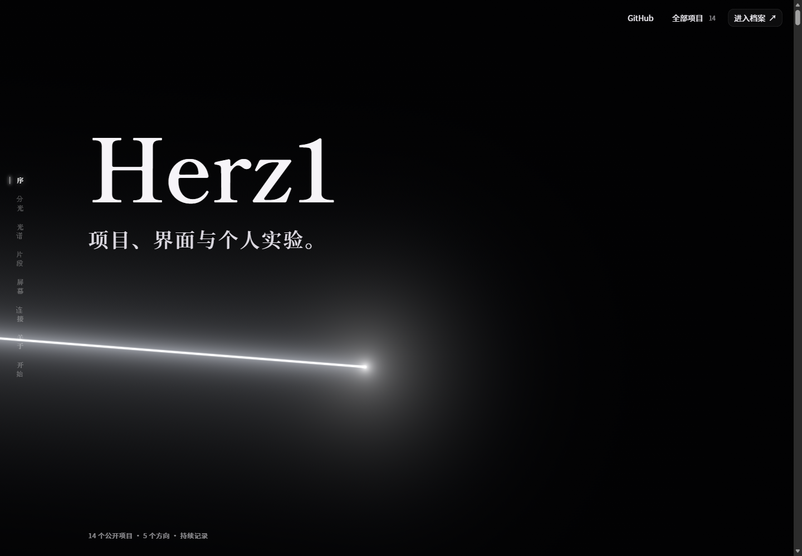
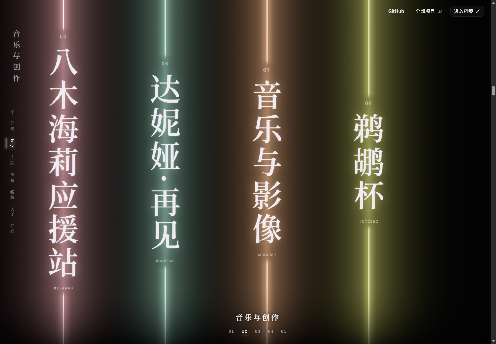

# Herz1 · Project Archive

**[打开个人首页](https://herz1.github.io/project-archive/)** · [全部项目](https://herz1.github.io/project-archive/projects/) · [三维档案](https://herz1.github.io/project-archive/archive/)

项目、界面与个人实验。将 Herz1 的全部公开 GitHub 仓库放进光谱与玻璃档案阵列，包括 Fork、空仓库、资源和学习记录。

沿用 RhineLabUI 与 Eidolon-SC 的原始实现：先在源码上换真实项目、品牌、链接和数量映射，再连接两套体验。保留完整八幕、原始开场、材质、模型、着色器与交互。另有无需三维和 JavaScript 即可访问的完整目录。




## 包里有什么

| 内容 | 当前状态 |
| --- | --- |
| Skill | [.agents/skills/rhine-eidolon-preserve/SKILL.md](.agents/skills/rhine-eidolon-preserve/SKILL.md) |
| Rhine 原始层 | 1,007 个文件；Web 源码、GLB、Blender 工程、字体、音频、内容和构建脚本 |
| Eidolon 原始层 | 499 个文件；前端源码、落地页字体、光层、时间线、手机模型和配套实现 |
| 保留证据 | 每个文件的 Git blob、SHA-256、字节数及固定上游提交 |
| 个人网站 | `website/intro` + `website/archive`，独立框架边界，合并为 GitHub Pages 静态站 |
| 轻量目录 | 全部公开项目的标准 HTML 链接；支持名称、标签、分类、语言与排序 |
| 预览适配 | 仍可生成两套原始体验，用于后续源码对照 |
| 首轮研究 | [图文报告](research/phase-1/reference-study.html)、20 张截图和 24 处源码定位 |

选入包内的 **1,506 个上游文件保持字节一致**，约 55.9 MiB。这里的“原样”有校验清单支撑，不表示打包了两个仓库的全部历史、后台或原站外部素材。

## 运行个人网站

使用 Node.js 24。在仓库根目录执行：

```sh
npm run setup:website
npm run build:website
npm run test:website
npm run preview:website
```

打开 http://127.0.0.1:4173/project-archive/ 。`npm run sync:projects` 更新全部公开仓库；人工展示文字与已确认的 Demo 位于 `website/content/projects.curated.json`。推送到 main 后由 GitHub Actions 构建、检查并发布。浏览器不需要 token。

完整开发和更新方法见 [website/README.md](website/README.md)，实际保留与适配证据见 [实现记录](website/docs/implementation.md)。

## 运行原始参考

需要 Node.js 22.18+ 和 npm。根项目无需安装依赖。

```sh
npm run verify
npm test

npm run setup:rhine
npm run dev:rhine
```

Rhine：http://127.0.0.1:5173

```sh
npm run setup:eidolon
npm run dev:eidolon
```

Eidolon：http://127.0.0.1:3000

工作副本生成在被忽略的 `work/rhine`、`work/eidolon`，不会改动原始层。构建检查使用 `npm run build:rhine`、`npm run build:eidolon`。

Eidolon 预览保留原始光、字体、分组、滚动和三维场景；使用随包角色元数据，不依赖原站后台。未打包的立绘、语音、卡图和体素会走上游已有回退；此预览没有账号或 AI 对话服务。

## 在后续任务中使用 Skill

这个仓库把 Skill 放在工作区可发现的 `.agents/skills/` 下。进入此仓库后，可以这样要求：

> 使用 $rhine-eidolon-preserve，基于随附原始源码继续制作我的 GitHub 项目总首页。大部分视觉、模型、材质和动效尽量原样保留，先替换真实项目数据和品牌。

独立 Skill 包也包含源码与适配器。它不依赖这个仓库的研究报告才能运行。完整用法见 [运行与整合](.agents/skills/rhine-eidolon-preserve/references/integration.md)。

## 原始层与工作副本

原始层继续保持 1,506 个文件逐字节一致；个人站在独立的 `website/` 工作副本上修改。[复用报告](website/docs/preservation-report.json) 逐文件区分原样内容、仅换行差异、适配与未复制文件，未以截图相似度冒充代码复用。第一步研究和 v0.1.0 Skill 发布仍保留，后续站点维护也继续使用同一 Skill。

## 下载与打包

- [独立 Skill / 完整整合包下载](https://github.com/Herz1/project-archive/releases/tag/v0.1.0)
- 本地执行 `npm run pack`，在 `dist/` 生成 `.skill`、整合包 ZIP 和 SHA256SUMS。
- `.skill` 是带完整技能目录的 ZIP，不包含 node_modules、工作副本、密钥或 Git 历史。

## 上游与许可

- [LBEILC/RhineLabUI](https://github.com/LBEILC/RhineLabUI) @ `12cc5e4013acb9408f753ff71de6b8492299b7c8`，MIT。
- [Sallyn0225/eidolon-sc](https://github.com/Sallyn0225/eidolon-sc) @ `cd1c61751eddeaf1bd4cdef4133e5e67f3af4ec5`，AGPL-3.0-or-later。

本仓库的整合、说明和适配层使用 [AGPL-3.0-or-later](LICENSE)。上游代码及第三方资产保留各自许可。手机模型、字体、Spine 和未随包素材的详细边界见 [THIRD_PARTY_NOTICES.md](THIRD_PARTY_NOTICES.md)。

原始参考的角色、标志和内容属于各相应权利人。它们用于原始体验的研究与复用对照，不代表 Herz1 的个人身份或项目。
