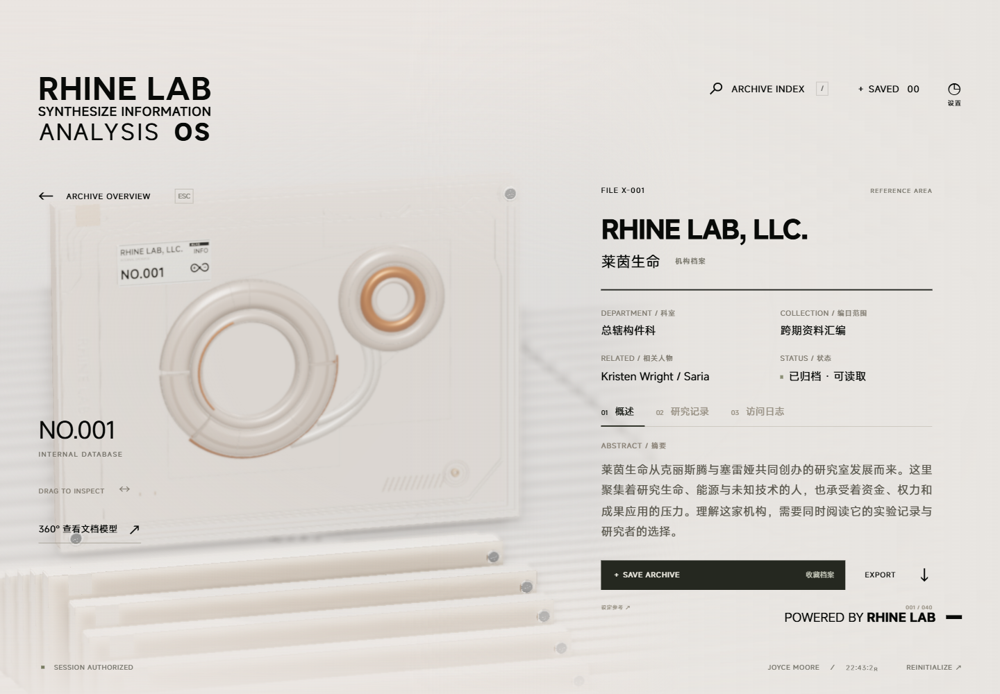
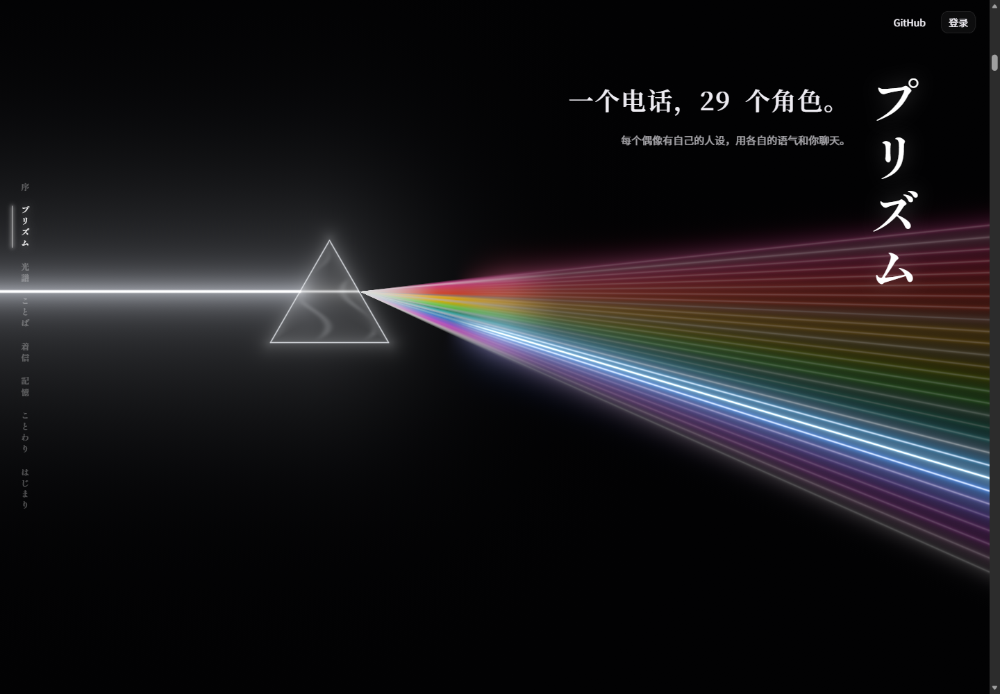

# Project Archive · Rhine × Eidolon

保留原始实现，再继续做个人项目总首页。

当前交付是 **可复用 Skill + 原样源码整合包**。后续 Herz1 的项目总首页也在这个仓库开发；目前尚未把参考内容替换成个人网站。




## 包里有什么

| 内容 | 当前状态 |
| --- | --- |
| Skill | [.agents/skills/rhine-eidolon-preserve/SKILL.md](.agents/skills/rhine-eidolon-preserve/SKILL.md) |
| Rhine 原始层 | 1,007 个文件；Web 源码、GLB、Blender 工程、字体、音频、内容和构建脚本 |
| Eidolon 原始层 | 499 个文件；前端源码、落地页字体、光层、时间线、手机模型和配套实现 |
| 保留证据 | 每个文件的 Git blob、SHA-256、字节数及固定上游提交 |
| 预览适配 | 复制原版运行材料；Eidolon 只替换数据入口和无后台接口，视觉组件没有重写 |
| 首轮研究 | [图文报告](research/phase-1/reference-study.html)、20 张截图和 24 处源码定位 |

选入包内的 **1,506 个上游文件保持字节一致**，约 55.9 MiB。这里的“原样”有校验清单支撑，不表示打包了两个仓库的全部历史、后台或原站外部素材。

## 快速运行

需要 Node.js 22.18+ 和 npm。根项目无需安装依赖。

```sh
npm run verify
npm test

npm run setup:rhine
npm run dev:rhine
```

Rhine：http://127.0.0.1:5173

```sh
npm run setup:eidolon
npm run dev:eidolon
```

Eidolon：http://127.0.0.1:3000

工作副本生成在被忽略的 `work/rhine`、`work/eidolon`，不会改动原始层。构建检查使用 `npm run build:rhine`、`npm run build:eidolon`。

Eidolon 预览保留原始光、字体、分组、滚动和三维场景；使用随包角色元数据，不依赖原站后台。未打包的立绘、语音、卡图和体素会走上游已有回退；此预览没有账号或 AI 对话服务。

## 在后续任务中使用 Skill

这个仓库把 Skill 放在工作区可发现的 `.agents/skills/` 下。进入此仓库后，可以这样要求：

> 使用 $rhine-eidolon-preserve，基于随附原始源码继续制作我的 GitHub 项目总首页。大部分视觉、模型、材质和动效尽量原样保留，先替换真实项目数据和品牌。

独立 Skill 包也包含源码与适配器。它不依赖这个仓库的研究报告才能运行。完整用法见 [运行与整合](.agents/skills/rhine-eidolon-preserve/references/integration.md)。

## 第二步从哪里继续

以选定参考生成 `website/` 工作副本，在原始实现上接入 Herz1 的真实项目。优先修改数据、链接、品牌和必要的布局接缝；不要重新搭一个无关模板。

最新要求是“最大化保留原来的精髓，允许大量原样保留”。[阶段二约定](docs/phase-2-handoff.md) 记录了这一优先级；第一步报告里缩短开场、默认重写的建议只保留为历史讨论。

## 下载与打包

- [独立 Skill / 完整整合包下载](https://github.com/Herz1/project-archive/releases/tag/v0.1.0)
- 本地执行 `npm run pack`，在 `dist/` 生成 `.skill`、整合包 ZIP 和 SHA256SUMS。
- `.skill` 是带完整技能目录的 ZIP，不包含 node_modules、工作副本、密钥或 Git 历史。

## 上游与许可

- [LBEILC/RhineLabUI](https://github.com/LBEILC/RhineLabUI) @ `12cc5e4013acb9408f753ff71de6b8492299b7c8`，MIT。
- [Sallyn0225/eidolon-sc](https://github.com/Sallyn0225/eidolon-sc) @ `cd1c61751eddeaf1bd4cdef4133e5e67f3af4ec5`，AGPL-3.0-or-later。

本仓库的整合、说明和适配层使用 [AGPL-3.0-or-later](LICENSE)。上游代码及第三方资产保留各自许可。手机模型、字体、Spine 和未随包素材的详细边界见 [THIRD_PARTY_NOTICES.md](THIRD_PARTY_NOTICES.md)。

原始参考的角色、标志和内容属于各相应权利人。它们用于原始体验的研究与复用对照，不代表 Herz1 的个人身份或项目。
